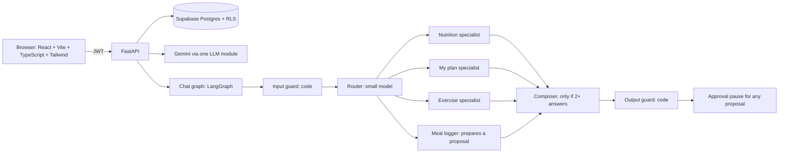

# AI Fitness Coach

A web app that acts as a personal fitness coach: it works out your calorie and macro targets, builds a 7-day meal plan from Indian or
Mediterranean foods and a weekly workout plan, lets you log meals, and answers questions in a chat. Every number comes from tested code
and a validated food database, not from the AI, and the AI can only *propose* changes: nothing is saved until you approve it.

> Status: a working basic version (Phases 0 to 7 of the roadmap). It runs locally. Weekly check-ins, the full dashboard, security
> hardening and production deployment are not built yet (see [What is not built yet](#what-is-not-built-yet)).

## What you can do in the app

| Screen | What it does |
|---|---|
| Sign up / sign in | Supabase login |
| Onboarding | Consent, body details, goal and pace, diet and cuisines, training setup, health screening. Ends with your daily targets |
| Home (the dashboard) | Today at a glance: calories and macros eaten against your targets, what you logged, what your meal plan and workout say for today, then your targets and a goal-date forecast (a range, not a promise) |
| Meal plan | The coach builds a 7-day plan from our food database; code works out the portions; you read it and **Approve** or **Reject** |
| Workout plan | Pick a split, the coach picks exercises from our library for your equipment and injuries; you approve; you can edit a day |
| Log a meal | Search foods, pick household units (katori, piece, bowl, cup), see totals. No AI involved |
| Chat (round button, bottom-left) | Ask about foods ("calories in 2 rotis", "which vegetarian foods are high in protein"), exercises ("how do I do a plank", "an alternative to bench press for a shoulder injury"), your own data ("what's my calorie target", "what's for lunch tomorrow", "what workout do I have on Monday", "am I on track this week"), or tell it what you ate ("I ate 2 rotis and dal for lunch"): it prepares the log and you press Approve to save it |
| Settings | Change your details, diet, cuisines and dislikes; your plans are marked out of date when they no longer match |

## How it is built



- **Frontend:** React 19, Vite, TypeScript, Tailwind CSS 4.
- **Backend:** Python, FastAPI, Pydantic, psycopg. Agents with LangGraph. Gemini through `langchain-google-genai`, all in one module.
- **Data:** Supabase (Postgres, Auth, Row Level Security). SQL migrations are in `supabase/migrations/`. Food and exercise data are built from open datasets
  (USDA FoodData Central, UK CoFID, Free Exercise DB) plus our own reviewed recipes, with sources and licences in `data/sources.json` and on the in-app Data sources page.

## Rules the project is built around

- **The AI never does math.** Calories, macros, portions, targets, trends and the meal-plan solver are plain Python with unit tests.
- **The AI never invents foods or exercises.** It picks from the database; code computes quantities.
- **Safety limits live in code** (`backend/app/safety/safety_config.py`), including calorie floors, deficit and protein caps, and the screening rules.
  Users with an eating-disorder history never see calorie or macro numbers, on any screen or in chat (enforced on the server and inside the chat tools).
- **No plan changes without approval.** Agents create a *proposal*; you approve it; then it is saved (and re-checked by code at that moment).
- **Guards without a model:** a crisis or harmful message is stopped by code before any AI runs, and every reply is checked on the way out.
- **Cost controls:** small model by default, mid-tier only for plan generation, only the last 6 messages plus a rolling summary are sent, every call has a token limit
  and is logged (tokens, cost, latency) in `agent_runs`, and each person is limited to 15 chat messages per 10 minutes and 150 per day.
- **Evals, not vibes:** guard evals, router, composer, nutrition, workout plan, meal plan and rolling-summary evals with real Gemini calls and pass/fail thresholds
  (`backend/evals/`). The router currently scores 100% on its 50 cases. Decisions and their reasons are in `docs/DECISIONS.md` (D-001 to D-103).

## Run it on your computer

You need: **Python 3.14 with [uv](https://docs.astral.sh/uv/)**, **Node 24 with npm**, a free **Supabase** project and a **Google AI Studio** (Gemini) API key.
Use the free Gemini tier with **test data only**: on the free tier Google may use prompts to improve its products. Enable billing before real people enter health data.

**1. Backend (`backend/`)**

```powershell
cd backend
uv sync
Copy-Item .env.example .env        # then fill in GEMINI_API_KEY, SUPABASE_URL, SUPABASE_PUBLISHABLE_KEY, SUPABASE_SECRET_KEY, DATABASE_URL
uv run python scripts/migrate.py   # creates the tables (use --dry-run first to preview)
uv run python -m fooddata.download # downloads the open datasets into data/raw/
uv run python -m fooddata.load     # loads the foods, synonyms and household units
uv run python -m exercisedata.load # loads the exercise library
uv run uvicorn app.main:app --reload
```

Check it: http://127.0.0.1:8000/health, http://127.0.0.1:8000/ready (also tests the database) and the API docs at http://127.0.0.1:8000/docs.

**2. Frontend (`frontend/`)**

```powershell
cd frontend
npm install
Copy-Item .env.example .env        # fill in VITE_SUPABASE_URL and VITE_SUPABASE_PUBLISHABLE_KEY (VITE_* values are public: never put a secret key here)
npm run dev
```

Open http://localhost:5173.

**Never commit `.env` files.** `.env.example` lists every setting.

## A 5-minute demo

1. Open the app, **sign up**, and finish **onboarding** (about 2 minutes). You land on Home with your targets and goal-date range.
2. **Meal plan** → *Generate my plan* (about a minute, about $0.04 of Gemini). Read the plan, open "How this plan was made" (which days the AI chose and which our code chose, the checks it passed), then **Approve**.
3. **Workout** → pick a split on the Splits screen, generate a plan, approve it.
4. **Log a meal**: search "roti", add 2 pieces and a katori of dal, and watch the totals.
5. Tap the round **chat button**: ask "how much protein is in paneer?", then "and how much fat?" (it remembers), then "what's for lunch tomorrow?", "what workout do I have on Monday?", "how do I do a plank?" and "which vegetarian foods are high in protein?".
   Then say "I ate 2 rotis and a katori of dal for lunch": a **Please confirm** card appears, nothing is saved yet, press **Approve** and go back to Home to see it in today's progress.
   Try "hello" or "make me a workout plan" to see how it redirects you to the right screen. Open **Past chats** to reopen or delete a conversation.
6. **Settings** → add the Mediterranean cuisine → your meal plan is marked out of date → generate a new one.

## Tests and evals

```powershell
cd backend
uv run pytest -v                   # offline tests (about 2,700), fast
uv run pytest -m db -v             # tests against your Supabase project (about 430), slower
uv run python -m evals.run         # guard evals and the regression gate, free
$env:PYTHONPATH='.'; uv run python -m evals.run_llm router    # model evals with REAL Gemini calls (fractions of a cent to a few cents each)

cd ../frontend
npm test                           # about 150 tests
npm run lint
npm run build
```

More commands (cost per day, protein report, Docker, food data tools) are in `CLAUDE.md`.

## What is not built yet

Honest list, so nobody is surprised:

- **Not deployed.** It runs locally. A backend `Dockerfile` exists and the plan is Vercel (frontend) and Render (backend), but there is no live URL and no CI yet (roadmap Phase 11).
- **Phase 8 to 10:** weekly check-in and weight trends, a weekly chart and the statistics pages (Home has a today dashboard), and hardening (data export, account deletion, security review, cost view). The privacy notice is a draft.
- **Chat is limited:** four specialists (foods and food rankings, your own plan, targets and progress, exercises from our library, and logging one meal at a time with your confirmation). Creating or changing plans stays on the plan screens; chat points you there. Replies arrive whole (no streaming). The LLM-judged guardrail layer (NeMo) and LangSmith tracing are planned, not built.
- **Food data:** 52 of our own recipes (Mediterranean and some Indian dishes) are drafted but not yet signed off by a reviewer, and the app labels their values "being checked". Two cuisines only (Indian, Mediterranean and Middle Eastern); English only.
- **Visual design is functional, not polished.** A redesign is planned after the backend is complete.
- **Not medical advice.** It is a coaching tool; the app tells users with health flags to check with a doctor.

## Project map

```
backend/app/        api (routes), agents (chat graph, specialists, guards), calc (all the math), db, llm, safety, schemas, workflows
backend/evals/      the model and guard evals, thresholds, and the regression gate
backend/fooddata/   building and checking the food database from open datasets
frontend/src/       pages and components (chat, plans, onboarding, settings, meals, ...)
supabase/migrations/ the database schema, with row level security on every user table
data/               ingredients, recipes, units, reports and source licences
docs/               PROJECT_BRIEF, PROGRESS, DECISIONS (every decision with options and reasons), AGENT_ARCHITECTURE, FLOWS_GUIDE
```

Start with `docs/AGENT_ARCHITECTURE.md` for how the agents fit together and `docs/DECISIONS.md` for why things are the way they are.
